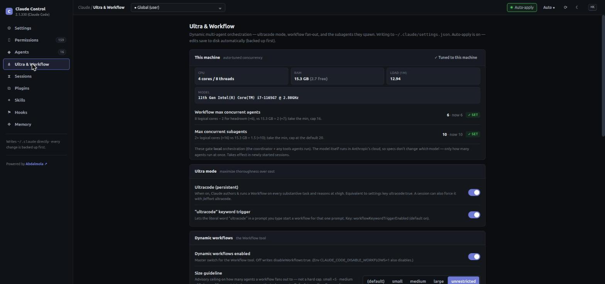

# Claude Control

A local, Linear-style control panel for [Claude Code](https://claude.com/claude-code)
configuration. Reads and writes the **real** files under `~/.claude` — nothing is
mocked, every write is backed up first, and the whole thing binds to `127.0.0.1` only.
**Bilingual** — English and clear Arabic (فصحى) with full RTL, one click.



<p align="center"></p>

## Features

| Module | Backs | Covers |
|---|---|---|
| **Settings** | `settings.json` | permission mode, model, effort, auto-compact (enable / window / % trigger), env vars, raw-JSON escape hatch. A **scope selector** switches between global `~/.claude/settings.json` and any project's `.claude/settings(.local).json` |
| **Permissions** | `permissions` | allow / deny / ask lists — add, remove, move between lists, search |
| **Agents** | `agents/*.md` | per-project subagents — browse, edit frontmatter (model, tools, effort) + body, create, duplicate, delete |
| **Ultra & Workflow** | `settings.json`, `env` | ultracode mode, dynamic-workflow fan-out (size guideline, usage warning, concurrency), subagent model/effort/limits, and **machine-aware tuning** — auto-detects CPU/RAM and recommends safe concurrency |
| **Sessions** | `projects/*/*.jsonl` | recent sessions with the one *working now* flagged live; running processes; search; pagination |
| **Plugins** | `settings.json`, marketplaces | enable/disable, install from a marketplace, add/remove marketplaces, search |
| **Skills** | `skills/**` | browse user + synced skills, search, delete user skills |
| **Hooks** | `hooks` | view event/matcher groups, search, edit raw |
| **Memory** | `projects/*/memory/*` | Entries / Index tabs — browse, search, improve (edit) or delete entries (index line pruned too) |

Every knob maps to a **real** Claude Code settings key or env var — nothing invented.

## Install

Needs **Python 3.10+** and **Node.js 18+**. Clone anywhere — no paths or usernames
are hardcoded; `$HOME` and the repo location are detected at runtime.

```bash
git clone git@github.com:abdalmola-apps/claude-panel.git
cd claude-panel
./install.sh                 # build + install a systemd user service on :8787
# PORT=9000 ./install.sh     # pick a different port
# ./install.sh --no-service  # just build, start it yourself with ./run.sh build
```

Then open **http://127.0.0.1:8787** (or `http://claude.localhost:8787` in Chrome —
`*.localhost` resolves to loopback automatically).

### Run without installing a service

```bash
./run.sh          # dev: FastAPI :8787 + Vite :5174 with HMR (open :5174)
./run.sh build    # build the SPA and serve everything from FastAPI on :8787
```

### Open it on a hostname without the `:port`

The installer prints this. It needs root once because it touches a web server:

```bash
sudo cp deploy/claude-control.apache.conf /etc/apache2/sites-available/claude-control.conf
sudo a2ensite claude-control && sudo systemctl reload apache2
# → http://claude-panel.localhost
```

If nothing holds port 80 on your box you can instead run the app there directly;
otherwise the Apache (or any reverse proxy) hostname approach above is cleanest.

### Managing the service

```bash
systemctl --user status  claude-control     # check
systemctl --user restart claude-control     # after a rebuild (npm run build)
systemctl --user disable --now claude-control
loginctl enable-linger "$USER"              # (optional) keep running when logged out
```

## Configuring project discovery

The panel auto-detects projects by scanning common dev folders under `$HOME`
(`Desktop`, `Documents`, `Projects`, `code`, `src`, `PycharmProjects`, …) for any
directory containing a `.claude` dir or a git repo. Point it elsewhere with:

```bash
CLAUDE_CONTROL_PROJECT_ROOTS="/work/clients:/opt/repos" ./run.sh build
```

## Safety

- **Backup before every write** → `~/.claude/.claude-control-backups/<name>.<timestamp>.bak`.
- **Validated** — `settings.json` is parsed and round-tripped before it lands; invalid JSON is rejected.
- **Merge, never clobber** — the whole object is loaded and written back, so keys the UI doesn't surface are preserved.
- **Path-jailed** — the backend refuses any write outside `~/.claude`.
- **Loopback only** — both the API and the dev server bind to `127.0.0.1`.
- Optional **auto-apply** (save on edit, with a backup) and a 30-second-then-default countdown on confirm dialogs.

## Stack

React 18 + TypeScript + Vite · FastAPI (stdlib-only parsing, no PyYAML) · systemd user
service · no database. The backend reads real hardware (`/proc`) for machine-aware
tuning and `~/.claude` for everything else.

## License

MIT
